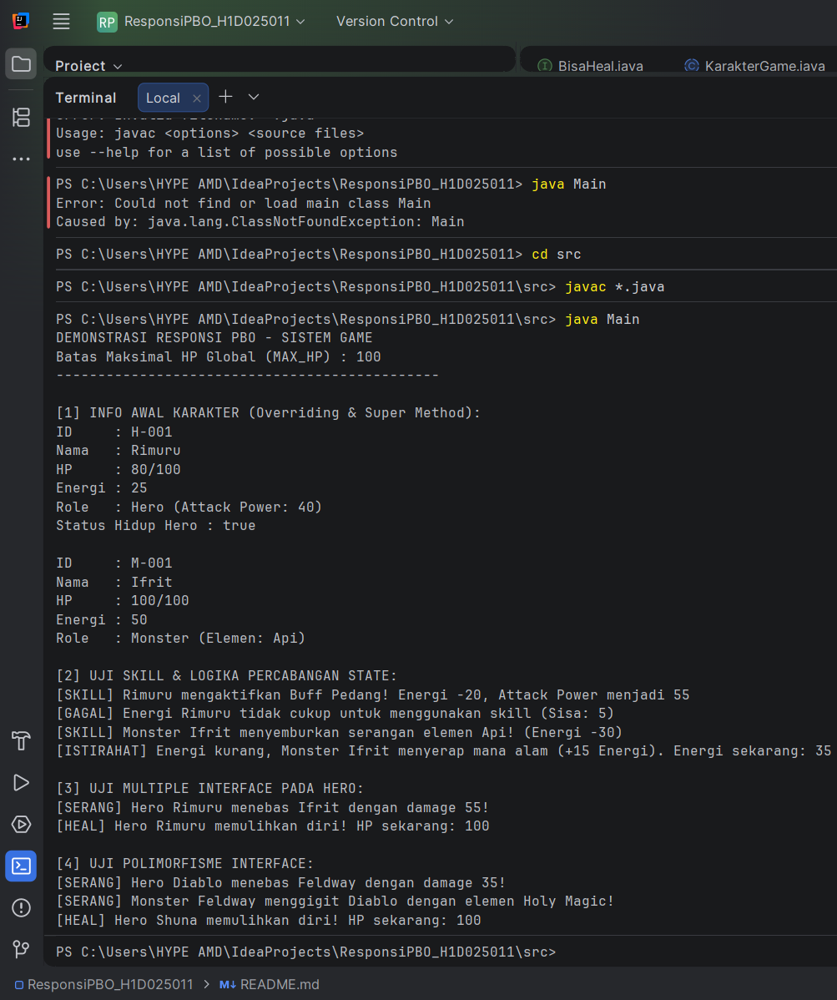

# Responsi Praktikum Pemrograman Berorientasi Objek (PBO)

## 1. Identitas Mahasiswa dan Tema
* **Nama** : Rizqi Ridwan Nawawi
* **NIM**  : H1D025011
* **Tema Sistem** : Game (RPG Sederhana)

---

## 2. Petunjuk Compile dan Run Melalui Terminal

Pastikan terminal mengarah ke dalam direktori `src` tempat berkas `.java` berada, lalu jalankan perintah di bawah ini.

1. **Masuk ke folder sumber kode:**
   ```bash
   cd src


2. **Kompilasi seluruh kode sumber Java:**
    ```bash
    javac *.java

3. Jalankan class utama:

    ```bash
    java Main

## 3. Screenshot Output


## 4. Struktur Code
```text
├── src/
│   ├── BisaHeal.java         # Interface pemulihan diri
│   ├── BisaMenyerang.java    # Interface aksi menyerang
│   ├── KarakterGame.java     # Abstract superclass (state, immutability, overloading)
│   ├── Hero.java             # Subclass Hero (multiple interface, super chaining)
│   ├── Monster.java          # Subclass Monster (inheritance, overriding)
│   └── Main.java             # Driver class pengujian dan polimorfisme
├── screenshot_output.png     # Bukti luaran terminal
└── README.md                 # Dokumentasi proyek

